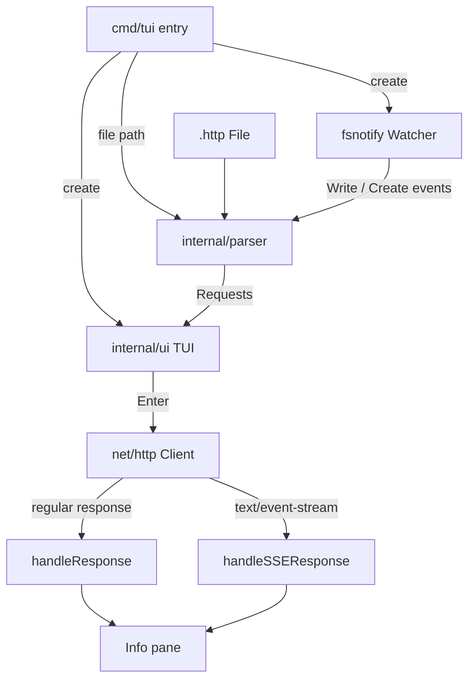

# Architecture

This page shows go-rest-client's layers and cross-layer rules in a single overview diagram; module internals, sequence diagrams, and the state machine live in [doc/architecture.md](https://github.com/pardnchiu/go-rest-client/blob/master/doc/architecture.md).

## System Overview

## Layers

| Layer | Path | Responsibility |
|-------|------|----------------|
| Entry | `cmd/tui/main.go` | Validate arguments, create the watcher and TUI, run the initial parse, start the event loop |
| Parsing | `internal/parser/parser.go` | Line-by-line `.http` parsing, header name validation, file watching and reload |
| UI and transport | `internal/ui/tui.go` | `tview` layout, key bindings, sending HTTP requests, rendering regular and SSE responses |

Both packages live under `internal/` and cannot be imported by other modules; `parser` depends on the `ui` types `TUI` and `Request`, while `ui` does not depend on `parser`.

## Cross-Layer Rules

| Rule | Implementation |
|------|----------------|
| Response rendering is queued to the event loop | The send goroutine and the reload timer update the info pane and hint bar via `App.QueueUpdateDraw`; `ReadFile` calls `UpdateLeftView` directly on its calling goroutine (main at startup, the timer goroutine on reload) |
| The request list is lock-protected | `TUI.Requests` is guarded by a `sync.RWMutex` (`TUI.Mu`) so reload writes and send reads do not interfere |
| Sending never blocks the UI | Each <kbd>Enter</kbd> runs in its own goroutine with a 120-second `context` timeout |
| Reloads are debounced | A 200ms timer merges bursts of write events; the timer itself is mutex-protected |
