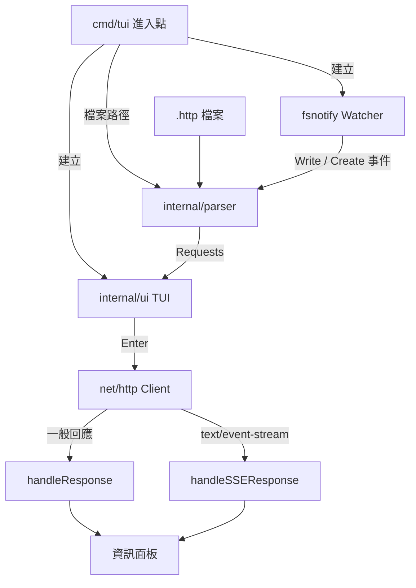

# 架構

本頁以一張概覽圖說明 go-rest-client 的分層與跨層原則；模組內部、序列圖與狀態機見 [doc/architecture.zh.md](https://github.com/pardnchiu/go-rest-client/blob/master/doc/architecture.zh.md)。

## 系統概覽

## 分層

| 層 | 路徑 | 職責 |
|----|------|------|
| 進入點 | `cmd/tui/main.go` | 驗證參數、建立 Watcher 與 TUI、首次解析、啟動事件迴圈 |
| 解析 | `internal/parser/parser.go` | `.http` 逐行解析、Header 名稱驗證、檔案監控與重載 |
| 介面與傳輸 | `internal/ui/tui.go` | `tview` 版面、按鍵綁定、送出 HTTP 請求、渲染一般與 SSE 回應 |

兩個 package 皆位於 `internal/`，無法被其他 module import；`parser` 依賴 `ui` 的 `TUI` 與 `Request` 型別，`ui` 不依賴 `parser`。

## 跨層原則

| 原則 | 實作 |
|------|------|
| 回應渲染排入事件迴圈 | 送出 goroutine 與重載計時器透過 `App.QueueUpdateDraw` 更新資訊面板與提示列；`ReadFile` 則在呼叫端 goroutine 直接呼叫 `UpdateLeftView`（啟動時為 main，重載時為計時器 goroutine） |
| 請求清單有鎖保護 | `TUI.Requests` 以 `sync.RWMutex`（`TUI.Mu`）保護，重載寫入與送出讀取不互相干擾 |
| 送出不阻塞介面 | 每次 <kbd>Enter</kbd> 在獨立 goroutine 執行，帶 120 秒 `context` 逾時 |
| 重載去抖動 | 200ms 計時器合併連續寫入事件，計時器本身以 mutex 保護 |
